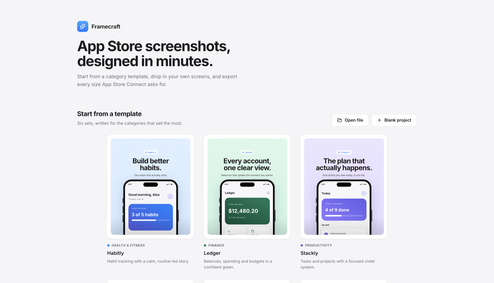

# Framecraft

An App Store screenshot editor. Start from a category template, drop your app
screens into a device frame, translate the copy, and export every size App
Store Connect asks for — from the browser or the terminal.



## Install

```bash
git clone https://github.com/AustineA/framecraft
cd framecraft
npm install
npm run dev
```

Open [http://localhost:3000](http://localhost:3000).

## What you get

- **Six templates**, one per top App Store category — health, finance,
  productivity, social, photo and shopping — each with written copy and a
  bright palette.
- **Thirteen device frames**, nine iPhone and four iPad, drawn to real
  hardware proportions in four finishes.
- **Six export sizes**, every dimension App Store Connect accepts:

  | Device | Pixels | Device | Pixels |
  | --- | --- | --- | --- |
  | iPhone 6.9″ | 1320×2868 | iPhone 5.5″ | 1242×2208 |
  | iPhone 6.5″ | 1284×2778 | iPad 13″ | 2064×2752 |
  | iPhone 6.3″ | 1206×2622 | iPad 12.9″ | 2048×2732 |

- **Eighteen locales** for slide copy. Translate per screen and per field;
  anything untranslated falls back to English, and exports land in
  per-locale folders (`en-US/`, `fr-FR/`).
- **Your own fonts.** Bundled stacks plus every font installed on your
  machine, searchable (Chromium-family browsers, with your permission).
- Editing you would expect: text edited directly on the canvas, undo and
  redo 50 steps deep, eighteen bright background presets, and free
  positioning of the device and text.

Projects autosave to your browser. Templates are a starting point, not a
constraint — every screen can be repainted, re-framed and rewritten.

## CLI (optional)

Every editor feature is also a command, so an agent can create a project,
write and translate copy, and export production-ready PNGs headlessly.

From your clone:

```bash
npm run install-cli
```

Or without cloning:

```bash
npx github:AustineA/framecraft install
```

Either way you get a `framecraft` command:

```bash
framecraft init --template finance --name Ledger
framecraft set --screen 1 --headline "Every account, one clear view."
framecraft translate --locale fr-FR --from fr.json
framecraft export --out ./shots
```

Commands act on the `framecraft.json` in the current directory, or the
nearest parent that has one — no path to pass around. Read state with
`--json` on any read command, and unknown flags are rejected rather than
ignored, so a typo fails loudly instead of quietly doing the wrong thing.

```bash
framecraft status      # where it installed from
framecraft uninstall   # remove it
```

### What an agent can drive

**Reference** — no project needed, all take `--json`:
`templates` · `locales` · `devices` · `frames` · `fonts` · `backgrounds` ·
`apps` · `browsers`

**Project** — `init` · `rename` · `show` · `screens` · `add` · `remove`

**Editing** — everything on a slide, via `set --screen <n|id|all>`:

| Group | Flags |
| --- | --- |
| Text | `--headline` `--subhead` `--brand-chip` (`\n` for a line break) |
| Type | `--font` `--font-size` `--subhead-size` `--align` |
| Canvas | `--bg` `--app` `--screen-name` |
| Device | `--frame` `--device-color` `--device-scale` `--device-x` `--device-y` |
| Text block | `--text-x` `--text-y` |
| Visibility | `--show`/`--hide` × `headline`, `chip`, `device`, `status` |
| Locale | `--locale` routes the edit into a translation |

**Translation** — `translate` (per field, or `--from <json>` in bulk) ·
`translations` (coverage, showing what still falls back) ·
`clear-translations`

**Export** — `export --out` with `--screen` `--devices` `--locales`
`--format` `--flat` `--simple-names` `--url` `--browser`, writing exact App
Store sizes into per-locale folders.

See [docs/CLI.md](docs/CLI.md) for the full reference.

## Sharing one file with an agent

Point the editor at a file on disk and both sides work on it live — no
exporting and re-importing:

1. Project menu → **Link to file on disk…** (or **Open file from disk…** for
   one an agent already made). Keep the suggested name, `framecraft.json`.
2. Run the agent in that folder. `framecraft` finds `framecraft.json` in the
   working directory or any parent, so no path is needed.

From then on the editor saves straight into that file, and edits the agent
makes to it appear in the editor within a couple of seconds. The link
survives reloads, and the header shows which file is attached.

Needs a Chromium-family browser (File System Access). Without it — or for a
one-off — the manual route still works: **Download file** in the project
menu, and **Open file** on the start screen.

Screens, translations, fonts, frames, positions, uploaded media and export
settings all travel in the file.

## Requirements

- Node.js 20.9+ (what Next.js 16 requires). The installed command pins the
  Node it was installed with, so switching Node versions — with mise, nvm,
  volta or asdf — does not hide it.
- A Chromium-family browser for export — Chrome, Chromium, Brave, Edge or
  Vivaldi, detected automatically

## License

MIT
